<!-- ===================== HEADER ===================== -->

<h2 align="center">
  Hello Fellow &lt; Developers /&gt;
  
</h2>

  

  
  
  

---

<!-- ===================== ABOUT ===================== -->
## 👽 About Me

👋 A passionate Computer Science graduate and aspiring Full Stack developer on a mission to build clean, user-friendly web applications and to learn how AI/ML can make software smarter. My GitHub is where I keep my projects, assignments and experiments as I grow from strong fundamentals to complete full-stack solutions.

Alongside development, I bring hands-on experience in **software testing** from my time at Endava, where I worked through the SDLC/STLC and wrote 25+ test cases. I care about quality as much as features.

  

#### 💼 What I do
- Build responsive, interactive front-end interfaces with **React.js** and **Tailwind CSS**
- Craft web pages with **HTML, CSS and JavaScript**
- Write programs in **Java** and **Python**, and I'm training in **Full Stack Java**
- Design relational databases and write queries with **MySQL**
- Train ML models with **Pandas, NumPy and scikit-learn**, and work on computer vision with **OpenCV**
- Test software by writing clear, thorough **manual test cases**

#### 🌱 Always learning
I believe in steadily building skills every day. Right now I'm going deeper into **Full Stack Java**, **Flask**, **DSA** and **AI/ML** through my IIT Patna course. My next big project is a **Document Q&A (RAG)** app that summarises PDFs and answers questions about them.

#### 🚀 Open to collaboration
I'm open to collaborating on web development and machine learning projects. If you have an idea to discuss or want to work together, feel free to reach out!

#### 💬 Let's connect
I believe in sharing knowledge. Explore my repositories, share your thoughts, and let's exchange ideas with fellow developers.

#### 🎯 Passionate about impact
My goal is to build applications that solve real-world problems and make people's lives easier. With every line of code, I want to make a difference.

**Happy coding and exploring! 🚀**

---

<!-- ===================== FIND ME HERE ===================== -->
## 🔍 Find Me Here

  
  

---

<!-- ===================== TECH SKILLS ===================== -->
## 🖱️ Tech Skills

### Frontend Enchantments

### Backend Wizardry

### AI / ML Alchemy

### Tool Mastery

### 🌱 Currently Learning

---

<!-- ===================== SOFT SKILLS ===================== -->
## 🤝 Soft Skills

---

<!-- ===================== CERTIFICATIONS ===================== -->
## 📜 Certifications

---

<!-- ===================== PROJECTS ===================== -->
## 🚀 Projects

| Project | What it does | Tech |
| :--- | :--- | :--- |
| 🧾 **Smart Invoice Analyzer** | Extracts data from invoices using OCR and NLP and flags suspicious ones with a RandomForest fraud-detection model. Team project, where I trained the fraud model. |    |
| 🎓 **IndigoLearn Landing Page** | Responsive landing page for an ACCA coaching institute: hero with callback form, course levels, placement assistance and a "Request Call Back" success modal. |    |
| 👤 **Face Recognition Attendance System** | Attendance system built during my ML internship at Krify IT Solutions that recognises faces to mark attendance, improving accuracy by 25%. |   |
| 🖥️ **Desktop Virtual Assistant** | A desktop virtual assistant built entirely in Python. |  |
| 📄 **Document Q&A (RAG)** 🚧 | *Coming soon:* upload a PDF to get an auto-summary, ask questions about it in simple language and take quizzes at different difficulty levels. |   |

> 🔗 More of my code is on [my GitHub repositories](https://github.com/ShaikAsifa2612?tab=repositories).

---

<!-- ===================== GITHUB STATS ===================== -->
## 📊 GitHub Stats

  

  

### 🍩 Circular Charts

  
  

  
  

---

<!-- ===================== QUOTE ===================== -->

  

---

<!-- ===================== CONNECT ===================== -->
## 😄 Can Connect With Me On

  
  

